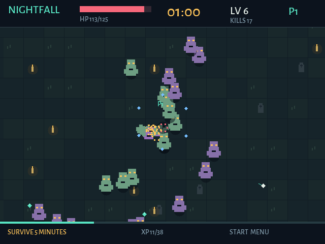

# Nightfall Survivors

Собственная компактная игра в духе Vampire Survivors для **Anbernic RG40XX H / muOS**. Маг, кладбище, орды противников, автоматические магические атаки и прокачка. Собственные правила и нарисованная кодом графика; оригинальные файлы Vampire Survivors не нужны.



## Документация и планы

- [Установка, управление, сеть и обновления](docs/INSTALL-RU.md)
- [План развития и следующих релизов](docs/ROADMAP.md)
- [Игровой дизайн и баланс](DESIGN.md)
- [Архитектура и сетевой протокол](docs/ARCHITECTURE.md)
- [Проведённые проверки и ограничения](docs/VERIFICATION.md)
- [Сборка и публикация релизов](docs/RELEASING.md)
- [История изменений](CHANGELOG.md)

В Releases доступны готовый комплект, отдельный архив документации и русская инструкция.

## Что работает в версии 0.1.1

- Забег на пять минут; для победы нужно также победить Стража, который появляется на четвёртой минуте.
- Три обычных типа врагов и босс, автонаведение, опыт и три варианта улучшения при повышении уровня.
- Шесть улучшений: урон, скорострельность, дополнительные снаряды, ледяная орбита, скорость/подбор, здоровье.
- До четырёх игроков по TCP/IP. Ведущий рассчитывает бой; клиенты передают управление. Опыт общий, улучшения индивидуальны. Союзник воскрешает павшего, находясь рядом три секунды.
- Меню с геймпада, клавиатура, сохранение звука и адреса соединения, синтезированные звуки.
- Проверка обновлений перед запуском на muOS, HTTPS + SHA-256, сохранение предыдущего бинарника и откат при сбое старта.

Клиенты macOS и Linux/ARM64 используют один протокол. С Windows, Android, iOS и другими консолями пока не проверялось; готовых клиентов для них нет. К самой Vampire Survivors эта игра не подключается.

## Установка на muOS

1. Установить PortMaster через средства muOS, чтобы загрузчик получил настройки окружения и контроллера.
2. Скачать `nightfall-0.1.1-muos.zip` из Releases.
3. Распаковать так, чтобы `Nightfall Survivors.sh` и папка `nightfall` лежали рядом в каталоге портов, который видит меню muOS. Для раздельной схемы: скрипт в `ROMS/PORTS`, данные в `/mnt/mmc/ports/nightfall` или `/mnt/sdcard/ports/nightfall`.
4. Запустить **Nightfall Survivors** из меню портов. При необходимости назначить скрипту ядро запуска External/Ports в muOS.

Точная раскладка SD-карты зависит от установленной muOS. На физическом RG40XX H версия 0.1.1 **ещё не проверена**: дисплей, звук, раскладка кнопок и фактические пути требуют проверки на устройстве. ELF/AArch64, игровой цикл, программный рендеринг и сетевые сессии проверены в Linux ARM64; нативное окно и кадр проверены на Mac.

Экран — 640 × 480. Требуется Linux ARM64 с glibc не старее версии сборки (Ubuntu 20.04 / glibc 2.31). SDL2 2.32 и C++ runtime включены в исполняемый файл; системные драйверы дисплея, ввода и звука предоставляет прошивка. Аппаратная производительность пока не измерена.

## Управление

| Действие | Приставка | Компьютер |
|---|---|---|
| Движение | Левый стик / крестовина | WASD / стрелки |
| Выбор пункта | Крестовина | Стрелки |
| Подтвердить | A | Enter / пробел |
| Назад | B / Select | Esc |
| Меню | Start | P / Esc |
| Изменить IP | Вверх/вниз — число, влево/вправо — часть | Стрелки |
| Подключиться | A на последней части IP / Start | Enter на последней части |

Стрельба автоматическая. В одиночной игре выбор улучшения останавливает бой; в сети бой продолжается, пока игрок выбирает улучшение или открывает меню. Физические подписи A/B зависят от SDL-раскладки, которую передаёт PortMaster.

## Игра с друзьями

У всех должна быть одинаковая версия. Один выбирает **HOST CO-OP** и сообщает IP, показанный над полем. Остальные выбирают **JOIN CO-OP** и вводят IPv4 ведущего. Порт — **TCP 40440**; его нужно разрешить в брандмауэре ведущего. Если у компьютера несколько сетевых интерфейсов, проверить, что показан адрес нужной Wi-Fi/локальной сети.

Первая цель — одна локальная сеть / Wi-Fi. Для удалённой игры нужен доступный IPv4 ведущего: например, маршрутизируемая частная сеть или перенаправление порта. Встроенного сервиса комнат, обхода NAT и выделенного публичного сервера пока нет. Транспорт не шифрует игровой трафик, поэтому используйте доверенную сеть. Вход во время забега разрешён; прогресс забега не сохраняется между запусками.

На ПК можно подключаться напрямую:

```sh
./build/nightfall --host
./build/nightfall --join 192.168.1.100
```

## Обновления

Загрузчик запускает `nightfall/update.sh` перед игрой. `update-url.txt` указывает на `latest-aarch64.txt` в GitHub Releases. Манифест содержит одну строку: `версия sha256 https_url_бинарника`. Публикуйте сначала файл игры, затем манифест, чтобы клиенты не увидели незавершённый релиз. Для тега `vX.Y.Z` CI собирает и публикует архив и манифест автоматически; тег должен совпадать с `VERSION`.

Проверка манифеста ограничена восемью секундами, скачивание — минутой и 8 МиБ. При отсутствии сети запускается установленная игра. Проверяются формат манифеста, HTTPS, SHA-256 и заголовок ARM64 ELF; старые и равные версии пропускаются. Источник обновления доверенный: checksum защищает от повреждения загрузки, а подлинность канала опирается на HTTPS и доступ к репозиторию. Обновление заменяет один бинарник со встроенной графикой/SDL2; загрузчик и настройки не перезаписываются.

Предыдущий бинарник остаётся в `nightfall.previous`. Новый процесс создаёт `launch.ready` после двух секунд работающего окна. Если обновлённая игра завершится до этого, загрузчик восстановит предыдущую версию и запустит её. Версия с неудачным стартом записывается в `failed-version` и повторно не устанавливается. Удаление этого файла разрешает повторную попытку; пустой файл `updates.disabled` отключает обновления. Повреждение старой установки не исправляется без рабочего исходного бинарника.

Настройки: `nightfall/save/settings.txt`. Лог запуска и обновлений: `nightfall/log.txt`. Ручной запуск бинарника обходит апдейтер; для обновлений запускайте скрипт из меню.

## Сборка

Нативная macOS / Linux, установлен SDL2:

```sh
make
make test
./build/nightfall
```

Linux ARM64 для muOS, Docker (закреплённый образ, на x86 нужен настроенный запуск ARM64-контейнеров):

```sh
docker run --rm --platform linux/arm64 -v "$PWD:/workspace" -w /workspace \
  --entrypoint bash "$(cat toolchain/image.lock)" packaging/build-arm64.sh
bash packaging/package.sh
```

После сборки готовый архив находится в `dist/`. В исходной общей рабочей папке RG40XX тот же рецепт можно вызвать через `./scripts/dev.sh bash games/nightfall/packaging/build-arm64.sh`.

Проверки: детерминированный бой и прокачка, 330 секунд нагрузки, смерть/воскрешение, босс/победа, границы пакетов и NaN, четыре реальных сетевых процесса, плохие пакеты и отключение ведущего, навигация контроллером и сценарии обновления/отката. `--demo --frames 800 --capture frame.bmp` запускает настоящую игру с автопилотом и сохраняет отрисованный кадр. Тестовый режим `--headless` использует SDL dummy-драйверы, а не физический дисплей.

## Зависимости и авторство

Игра написана с помощью Codex по заказу владельца проекта. Графика, шрифт и звук создаются внутри программы. Спасибо Sam Lantinga и сообществу SDL за SDL2; настройки запуска основаны на документации PortMaster. Лицензии включённых библиотек — в `licenses/`. Лицензию собственных исходников определяет владелец репозитория; права на сторонние игры не включены.
