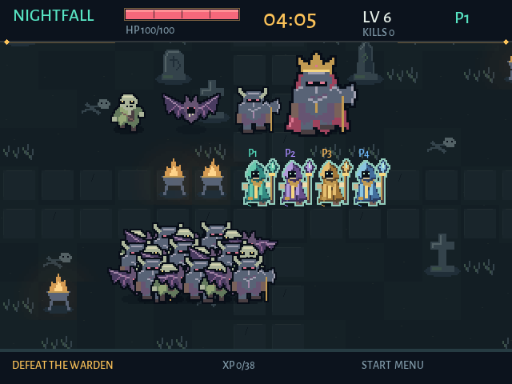
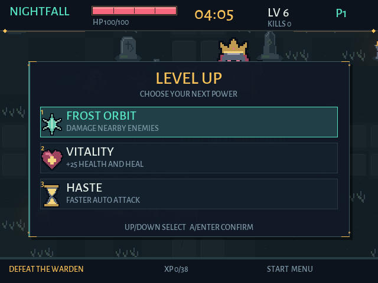

# Графика Nightfall Survivors — 0.1.4

Тёмное пиксельное фэнтези: холодное кладбище, тёплые жаровни, бирюзовая магия и потускневшее золото. Детали строятся крупными цветовыми пятнами, читаемыми на экране RG40XX H 640 × 480. Контраст земли ниже контраста противников, герой выделен светлым краем и цветом команды. Мелкие эффекты не перекрывают героя.





## Персонажи и окружение

- Четыре варианта мага: бирюзовый, лиловый, янтарный и голубой. Плащ со складками, капюшон, деревянный посох с кристаллом. Цвет команды читается по всему плащу.
- Мертвец: неровный силуэт, открытые кости, рваная одежда и вытянутые руки.
- Летучая тварь: четыре положения перепончатых крыльев и узкое тело.
- Страж: широкие металлические наплечники, рога, топор, красная щель забрала.
- Хранитель: увеличенный силуэт стража, корона и рваный багровый плащ.
- Каменные кресты, обелиски, треснувшие надгробия, кости, трава, анимированные жаровни и тёплый свет на земле. Каменная дорожка проходит через середину арены. Декорации не создают препятствий.
- Улучшения имеют шесть отдельных значков. Интерфейс сохраняет Cinzel Decorative и Alegreya Sans, золотые углы и тёмные подложки.

## Формат и воспроизведение

Исходник: `assets/sprites/source.py`. Это собственные рисунки в целочисленных координатах, без файлов других игр. Атлас собирается командой `python3 tools/bake_sprites.py`; зависимость — Pillow 11.3.0 из `tools/requirements-fonts.txt`.

Результат: `assets/sprites/atlas.png`, подписанный `preview.png` и встроенный `src/sprite_data.hpp`. 50 кадров, ячейка 48 × 48, атлас 384 × 336; точка опоры (24, 40). Персонажи показаны в масштабе 2×, босс — 3×. Масштабирование только ближайшим соседом. Кадры анимации созданы в исходнике; четыре кадра не требуют интерполяции. Полупрозрачность используется для теней и локального света, края персонажей резкие.

Палитровый атлас распаковывается и загружается в одну текстуру при запуске. При отрисовке используются обрезанные границы кадров; каждый персонаж требует одну операцию копирования, тени — отдельный проход под персонажами. Нет чтения PNG, генерации изображений или загрузки внешних ассетов во время боя. Поэтому обновление одного бинарника включает новую графику.

## Визуальная проверка

`--benchmark` — обычный бой, `--stress` — 240 врагов. Сохранить кадры через `--capture`, а на приставке дополнительно снять физический framebuffer. Проверить силуэты, наложения, видимость героя, снаряды, HUD и частоту кадров.

Для воспроизводимого обзора всех команд, врагов и шести значков:

```sh
c++ -std=c++17 -Isrc $(sdl2-config --cflags) tools/render_art_review.cpp -o build/art-review $(sdl2-config --libs)
./build/art-review
```

Кадры `build/art-review-*.bmp` показывают настоящий игровой рендер в 640 × 480, а не отдельный макет.

На RG40XX H / muOS 2601.0 с открытым контроллером итоговый короткий тест с 240 врагами дал 59,83 FPS. [Физический экран и метрики](HARDWARE-TEST.md) сохранены отдельно от программных обзорных кадров выше.
