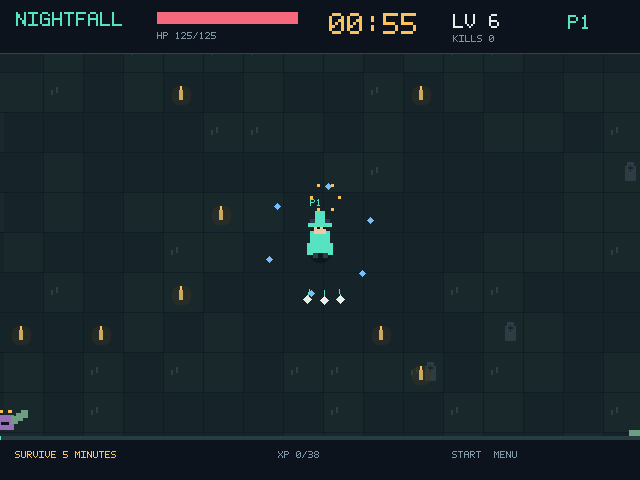

# Первая установка на RG40XX H — 20 октября 2026

Статус: **установлена, первичная проба запуска прошла; полный аппаратный тест отложен**. На устройстве параллельно проверяется отдельная игра District, поэтому экран, звук и производительность повторно не тестируем до освобождения приставки.

## Подтверждено на устройстве

| Параметр | Наблюдение |
|---|---|
| Прошивка | MustardOS 2601.0 (JACARANDA), BUILD_ID bc38efa0 |
| Архитектура и ядро | aarch64, Linux 4.9.170 |
| libc | glibc 2.38 |
| Дисплей | `/dev/fb0`, 32 bpp, virtual_size 640 × 960; `/dev/dri` отсутствует |
| PortMaster | `/mnt/mmc/MUOS/PortMaster` |
| Контроллер | muOS-Keys, GUID `19000000010000000100000000010000`, 4 оси, 17 кнопок, 1 hat |
| Маппинг SDL | В `/usr/lib/gamecontrollerdb.txt` есть соответствующий GUID с именем Deeplay-keys |

Игра установлена в `/mnt/mmc/ports/nightfall`, ярлык — `/mnt/mmc/ROMS/PORTS/Nightfall Survivors.sh`. Другие игры и системные библиотеки не изменялись. Бинарник из опубликованного релиза 0.1.1; SHA-256: `8a0a42d47d32e5d99a124c7aebab62a72397de3fd4dd64da6d3915f91ba9d9a7`.

Проверки:

- `--version` вернул `0.1.1`.
- `--self-test` прошёл непосредственно на приставке: симуляция, бой, опыт, воскрешение, босс, пакеты и 330 секунд симуляционной нагрузки.
- `--demo --frames 20 --capture ...` завершился с кодом 0 и создал игровой кадр 640 × 480.
- Кадр, сохранённый SDL-отрисовкой игры на устройстве, скопирован и визуально проверен. Это не фотография физического экрана.
- В загрузчик добавлены реальные пути PortMaster `/mnt/mmc/MUOS/PortMaster` и `/mnt/sdcard/MUOS/PortMaster`. Исправленный ярлык установлен, но его полный запуск через меню ещё не проверен.

Отсутствие DRM-узлов не помешало первичной графической инициализации текущей SDL2-сборки. Менять графические библиотеки на основании одного этого признака не потребовалось.

## Следующая проверка — когда устройство освободится

1. Запустить Nightfall из меню портов; подтвердить, что PortMaster подхватил нужный SDL-маппинг.
2. Проверить физический экран, оба стика, крестовину, A/B, Start/Select, выбор усиления и корректный выход в меню muOS.
3. Проверить слышимый звук, регулировку громкости, повторный запуск и сохранение настроек.
4. Измерить FPS/память во время одиночного забега и полной волны без параллельных графических тестов; результаты первой короткой пробы для оценки производительности не использовать.
5. Проверить совместную сессию с компьютером и воскрешение.
6. Проверить обновления и откат на устройстве, включая запуск без интернета.

До завершения этих шагов нельзя считать аппаратную совместимость и игровой опыт полностью подтверждёнными. Загрузчик и документация пока исправлены в исходниках и на устройстве; полный архив релиза 0.1.1 остаётся исходным, в нём этого исправления пути ещё нет. Обновление бинарника не меняет загрузчик, поэтому исправление нужно включить в следующий полный установочный архив.
