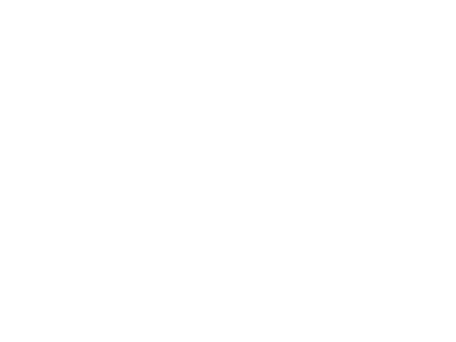
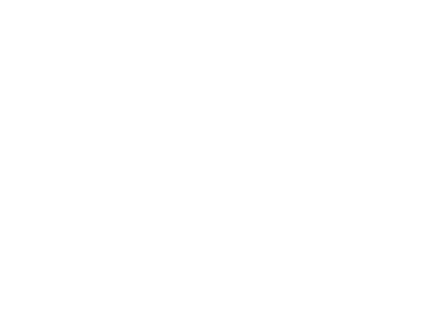

# Проверка RG40XX H / muOS — 20 октября 2026

## Дополнение: различимость толпы в 0.1.3

Версия 0.1.3 установлена на эту же приставку; SHA-256 установленного файла совпадает со сборкой релиза. На физическом framebuffer 640 × 480 проверены новые контуры, силуэты, приглушённый фон и выделение героя. Предельная сцена: **240 врагов, до 31 снаряда, 1200 кадров / 20,15 с, 59,56 FPS, p95 16,92 мс, p99 17,12 мс**. Это короткая проверка, не длительный тепловой тест. Проверки управления и звука ниже относятся к 0.1.2; в 0.1.3 изменена только отрисовка.

[Метрики 0.1.3](hardware/results/readability-stress-0.1.3.json).

Установлена и проверена **Nightfall Survivors 0.1.2**. Исправлены чёрный экран, тихий/нулевой аудиовыход и путь к PortMaster; обновлена типографика по пожеланию пользователя.

## Устройство и установка

- RG40XX H, muOS **2601.0 JACARANDA**, BUILD_ID bc38efa0, aarch64, Linux 4.9.170, glibc 2.38.
- Дисплей: `/dev/fb0`, 640 × 480, 32 bpp; `/dev/dri` отсутствует.
- Игра: `/mnt/mmc/ports/nightfall`, ярлык: `/mnt/mmc/ROMS/PORTS/Nightfall Survivors.sh`.
- PortMaster: `/mnt/mmc/MUOS/PortMaster`; контроллер muOS-Keys, SDL-раскладка Deeplay-keys, GUID `19000000010000000100000000010000`.
- Физический вывод: `VIDEO mali RENDERER opengles2`; звук: `AUDIO alsa`, PipeWire, системный sink аудиокодека card0.

## Исправленный экран и шрифты

Первый self-test 0.1.1 и сохранение кадра SDL дали ложное впечатление готовности видеовывода. Пользователь подтвердил чёрный экран. Статическая SDL2 из стандартного контейнера выбирала offscreen, который рисовал в памяти и не выводил изображение на приставку.

В 0.1.2 используется системная SDL2 muOS с Mali framebuffer backend. Невидимый offscreen/dummy при обычном запуске отклоняется. Изображение подтверждено пользователем и снимками настоящего framebuffer.

Заголовок оформлен Cinzel Decorative Bold, остальные надписи — Alegreya Sans Medium. Исходники TTF и SIL OFL сохранены; атласы запечены в бинарник. Визуально проверены меню, помощь, пауза, ввод IP и игровой HUD в 640 × 480.

## Управление — автоматизированная проверка настоящего устройства ввода

С согласия пользователя события подавались в `/dev/input/event1`, затем проходили штатный SDL-маппинг muOS. Состояния игры читались через явный диагностический режим `--audit`. Это проверяет драйвер/раскладку/игру, но не механическое состояние кнопочных переключателей.

- Крестовина перемещает выбор в меню; A открывает справку и запускает соло; B возвращает.
- Отклик аналогового стика проверен отдельно: герой сдвинулся на **93.93** единицы.
- Отклик крестовины в бою проверен отдельно: **135.00** единицы.
- Start открывает паузу, B продолжает игру; выход из забега возвращает в меню.
- Проверены ввод IP, переключение звука и штатный выход через QUIT.
- Посещены все пять состояний интерфейса (`views_visited=31`); завершение `exit_reason=MENU_QUIT`; игровая дистанция **228.93**.

Для воспроизведения: явно запустить игру с `--audit /mnt/mmc/ports/nightfall/hardware-live.json`, приостановить другие графические меню и выполнить `tools/hardware_controls.py` на устройстве. Скрипт не входит в обычные автотесты и не должен работать поверх другой программы. Аналоговый GPIO-драйвер периодически обновляет состояние осей, поэтому диагностическая подача удерживаемого значения повторяется; после теста оси и кнопки отпускаются.

## Звук

Пользователь сообщил об отсутствии звука. Первая loopback-запись выхода встроенного динамика подтвердила тишину: peak=0, RMS=0, хотя SDL открыл устройство.

Исправление: stereo PCM **44,1 кГц**, заполнение очереди до начала воспроизведения, более отчётливый уровень синтезированных эффектов и звуки меню. Системная громкость и аппаратные настройки не изменялись.

После исправления запись того же выхода содержит игровой звук: peak **6975 / 32767**, RMS **586.28**, ненулевых отсчётов **86080**. Запись референсного тона отдельно подтвердила правильность выбранного monitor-канала. В финальном тесте игра успешно поставила в очередь **23** звука.

Это цифровая запись внутреннего выхода аудиокодека, не акустическая запись динамика микрофоном. Физическую слышимость после исправления пользователь повторно не подтверждал.

## Производительность

Финальная 20-секундная стресс-проба на настоящем устройстве, без вмешательства кнопками:

| Сцена | Кадры | Время | Средний FPS | p95 кадра | p99 кадра |
|---|---:|---:|---:|---:|---:|
| 240 врагов, до 31 снаряда | 1200 | 20.05 с | **59.84** | 16.82 мс | 16.95 мс |
| Сценарий меню/управления | 919 | 15.39 с | 59.71 | 16.80 мс | 17.18 мс |

В предыдущей стресс-пробе этой же ветки 0.1.2 наблюдавшийся максимум RSS был около **61 МиБ** (VmHWM считывался каждые две секунды). До исправления VSync меню показывало около 55 FPS; двойное ожидание кадра устранено.

Исходные JSON, результаты раздельных проверок движения, анализ аудио и снимки экранов: `docs/hardware/results/`. `--stress --frames 1200 --report result.json` повторяет предельную сцену; `--benchmark` — обычный бой с автопилотом. В режиме замера кнопки меню игнорируются, системный выход остаётся доступным.

## Обновления и оставшиеся проверки

При запуске через установленный скрипт проверка GitHub завершилась DNS-таймаутом; установленная игра корректно открылась офлайн. Сетевые настройки приставки не менялись. Полное скачивание/откат на устройстве при рабочем внешнем DNS пока не проверены.

Также остаются долгий тепловой прогон, сон/возобновление, длительное наблюдение памяти, полная сетевая партия на приставке и акустическое подтверждение динамика. Короткая 20-секундная проба не доказывает стабильность длительного сеанса.
